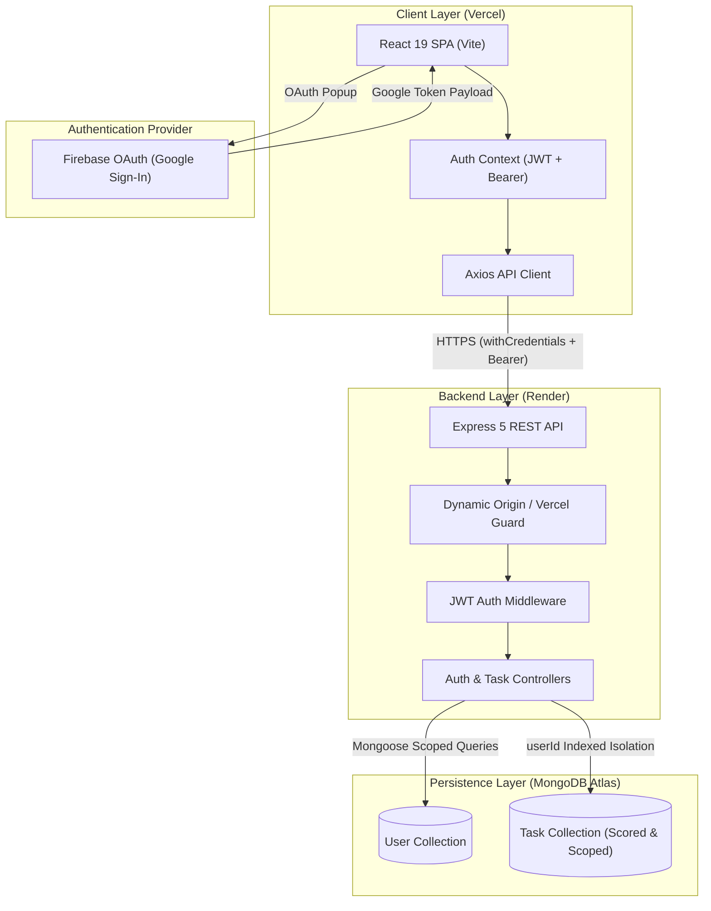

<p align="center">
  
</p>

<h1 align="center">TaskFlow — Personal Task & Productivity Engine</h1>

<p align="center">
  <b>A modern, full-stack MERN productivity ecosystem engineered for high-velocity personal task management, automated deadline tracking, and deep workflow clarity.</b>
</p>

<p align="center">
  <a href="https://taskflow-one-lilac.vercel.app" target="_blank">
    
  </a>
  <a href="https://taskflow-server-wz2r.onrender.com" target="_blank">
    
  </a>
  <a href="https://github.com/rajesh432sarraf/taskflow" target="_blank">
    
  </a>
  <a href="#license">
    
  </a>
</p>

<p align="center">
  
  
  
  
  
  
  
</p>

---

## 📑 Table of Contents

- [Overview](#-overview)
- [Live Deployments](#-live-deployments)
- [Key Features](#-key-features)
- [Architecture & Data Flow](#-architecture--data-flow)
- [Tech Stack](#-tech-stack)
- [Project Directory Structure](#-project-directory-structure)
- [RESTful API Endpoints](#-restful-api-endpoints)
- [Getting Started Locally](#-getting-started-locally)
- [Automated Testing & QA](#-automated-testing--qa)
- [Security & Production Hardening](#-security--production-hardening)
- [Contributing & Author](#-contributing--author)
- [License](#-license)

---

## 🌟 Overview

**TaskFlow** is an enterprise-grade, full-stack personal task and workflow management system built with the MERN stack (MongoDB, Express, React, Node.js). Designed with an obsidian-emerald luxury aesthetic inspired by cutting-edge SaaS design, TaskFlow eliminates cognitive overload through intuitive task organization, automated overdue detection, multi-criteria filtering, and real-time velocity metrics.

### Why TaskFlow?
- ⚡ **Split-Screen Interactive Authentication:** Clean obsidian-emerald dark container with Google One-Tap OAuth and an auto-playing animated productivity carousel with smooth pagination.
- 🎯 **Total Multi-Tenant Isolation:** Guaranteed zero cross-user access leaks with MongoDB user-scoping on every query.
- 🛡️ **Dual-Layer Authentication Resilience:** Secure HTTP-only cookies paired with automatic Bearer token headers for seamless cross-domain operation between Vercel and Render.
- 📊 **Executive Productivity Metrics:** Instant dashboard analytics tracking velocity rate, active milestones, and overdue buffers.

---

## 🚀 Live Deployments

| Component | Platform | Live URL | Status |
| :--- | :--- | :--- | :--- |
| **Frontend SPA** | **Vercel** | [taskflow-one-lilac.vercel.app](https://taskflow-one-lilac.vercel.app) |  |
| **Backend REST API** | **Render** | [taskflow-server-wz2r.onrender.com](https://taskflow-server-wz2r.onrender.com) |  |
| **API Health Probe** | **Render** | [taskflow-server-wz2r.onrender.com/api/health](https://taskflow-server-wz2r.onrender.com/api/health) |  |
| **Database Cluster** | **MongoDB Atlas** | Cloud Replica Set (`AWS / Mumbai`) |  |

---

## ✨ Key Features

### 🔐 1. Resilient Authentication System
- **Dual Sign-In Experience:** Secure email & password authentication (with bcrypt salted hashing) or instantaneous "Continue with Google" via Firebase OAuth popup.
- **Cross-Domain Persistence:** JWT issued via HTTP-Only `SameSite: None` + `Secure` cookies, backed by automatic Bearer token localStorage hydration to protect against third-party cookie restrictions.
- **Session Integrity:** Automated session verification via `/api/auth/me` with non-blocking initial hydration.

### 📋 2. Comprehensive Task Lifecycle (Full CRUD)
- **Granular Fields:** Task title, markdown description, priority level, execution status, and precise due dates.
- **Priority Tiers:** Categorize actions into `Low`, `Medium`, and `High` priority with luminous visual indicators.
- **Status State Machine:** Smooth transitions between `Pending`, `In Progress`, and `Completed`.
- **Intelligent Overdue Warning:** Real-time calculation flagging overdue items that require immediate attention.

### 📊 3. High-Velocity Dashboard Analytics
- **Live Counter Widgets:** Instant breakdown of Total Tasks, Pending Workflows, Active In-Progress items, and Completed Milestones.
- **Momentum Progress Bar:** Visual completion percentage tracking daily progress velocity.
- **Dynamic Greeting:** Context-aware personalized welcome banner showing date and action counts.

### 🔍 4. Multi-Criteria Filtration & Search
- **Instant Search:** Debounced full-text search matching task titles and descriptions.
- **Composite Query Filters:** Combine status filters (`All`, `Pending`, `In Progress`, `Completed`) with priority filters (`All`, `Low`, `Medium`, `High`) with zero page reloads.

### 🎨 5. Luxury Obsidian-Emerald Aesthetic
- **Color Philosophy:** Rooted in deep emerald and obsidian blacks (`#010001`, `#040D0A`, `#133336`, `#10B981`) crafted for eye comfort during long focus sessions.
- **Micro-Interactions:** Subtle floating card animations (`animate-float-slow`, `animate-float-delay`), hover card elevations, glowing focus rings, and animated pagination pills (`▬ • •`).
- **Mobile Responsive Drawer:** Seamless sliding sidebar drawer on mobile and tablet displays.

---

## 🏛️ Architecture & Data Flow



---

## 🛠️ Tech Stack

| Domain | Technology | Description |
| :--- | :--- | :--- |
| **Frontend Framework** | [React 19](https://react.dev/) | Declarative component architecture with concurrent rendering |
| **Build Tooling** | [Vite 8](https://vite.dev/) | Lightning-fast HMR and optimized production bundling |
| **Styling** | [Tailwind CSS v4](https://tailwindcss.com/) | Next-generation utility-first styling engine with CSS variables |
| **Iconography** | [Lucide React](https://lucide.dev/) | Clean, consistent SVG icon system |
| **Client Routing** | [React Router DOM v7](https://reactrouter.com/) | Declarative client-side routing with protected view guards |
| **OAuth Service** | [Google Firebase Auth](https://firebase.google.com/) | Fast and secure Google identity authentication |
| **Backend Runtime** | [Node.js (v18+)](https://nodejs.org/) | Scalable asynchronous JavaScript runtime |
| **Web Framework** | [Express 5](https://expressjs.com/) | Modern web server framework with promise-based middleware |
| **Database** | [MongoDB Atlas](https://www.mongodb.com/atlas) | Cloud-native NoSQL document database cluster |
| **ODM Modeling** | [Mongoose 8](https://mongoosejs.com/) | Schema validation and typed business logic |
| **Security** | [Bcrypt.js](https://github.com/dcodeIO/bcrypt.js) & [JWT](https://jwt.io/) | Salted password hashing & signed token authorization |
| **Hosting (Client)** | [Vercel](https://vercel.com/) | Edge-network global frontend deployment |
| **Hosting (API)** | [Render](https://render.com/) | Fully managed cloud web service deployment |

---

## 📁 Project Directory Structure

```text
TASKFLOW/
├── client/                          # React + Vite Frontend
│   ├── public/                      # Static assets, logos & favicons
│   │   ├── favicon.svg              # Brand SVG vector icon
│   │   └── logo.png                 # Official brand logo
│   ├── src/
│   │   ├── components/              # Modular UI components
│   │   │   ├── common/              # Button, Input, Modal, Loader, StatCard
│   │   │   ├── layout/              # Navbar, Sidebar, Footer
│   │   │   └── tasks/               # TaskCard, TaskForm, SearchBar, FilterBar
│   │   ├── config/                  # Firebase SDK client initialization
│   │   ├── context/                 # AuthContext (state & session management)
│   │   ├── layouts/                 # AppLayout (protected shell)
│   │   ├── pages/                   # LoginPage, RegisterPage, DashboardPage, TasksPage
│   │   ├── services/                # Axios instance (api.js), authService, taskService
│   │   ├── App.jsx                  # Main routing tree
│   │   ├── index.css                # Tailwind directives & keyframe animations
│   │   └── main.jsx                 # React root mount
│   ├── package.json
│   ├── vercel.json                  # SPA client rewrite rules
│   └── vite.config.js
│
├── server/                          # Express + Node.js Backend
│   ├── config/                      # MongoDB Atlas connection (db.js)
│   ├── controllers/                 # authController.js, taskController.js
│   ├── middleware/                  # authMiddleware, validator, errorHandler, notFound
│   ├── models/                      # User.js, Task.js (Mongoose Schemas)
│   ├── routes/                      # authRoutes.js, taskRoutes.js
│   ├── tests/                       # integration.test.js, e2e_integration.test.js
│   ├── utils/                       # jwtUtils.js (token signing & cookie options)
│   ├── package.json
│   └── server.js                    # Express application entry & CORS policy
│
├── render.yaml                      # Infrastructure as Code for Render Cloud
└── README.md                        # Documentation & Architecture Showcase
```

---

## 🔌 RESTful API Endpoints

### 🔐 Authentication Routes (`/api/auth`)

| Method | Endpoint | Access | Description |
| :--- | :--- | :--- | :--- |
| `POST` | `/api/auth/register` | Public | Register new user with email, name, password |
| `POST` | `/api/auth/login` | Public | Authenticate user with credentials & issue token |
| `POST` | `/api/auth/google` | Public | Exchange Firebase Google payload for JWT session |
| `POST` | `/api/auth/logout` | Authenticated | Terminate session and clear authentication cookie |
| `GET` | `/api/auth/me` | Authenticated | Retrieve profile of currently authenticated user |

### 📋 Task Management Routes (`/api/tasks`)

| Method | Endpoint | Access | Description |
| :--- | :--- | :--- | :--- |
| `GET` | `/api/tasks` | Authenticated | Fetch user's tasks (supports `search`, `status`, `priority`) |
| `POST` | `/api/tasks` | Authenticated | Create a new task scoped to user |
| `GET` | `/api/tasks/:id` | Authenticated | Fetch a specific task (isolated by user ID) |
| `PUT` | `/api/tasks/:id` | Authenticated | Update task fields (title, priority, status, dueDate) |
| `DELETE` | `/api/tasks/:id` | Authenticated | Permanently delete a task |
| `GET` | `/api/tasks/stats` | Authenticated | Retrieve aggregated dashboard counts and completion rates |

---

## 💻 Getting Started Locally

### 1. Prerequisites
- **Node.js:** v18.0.0 or higher
- **Git** installed on your workstation
- **MongoDB Atlas** account (or local MongoDB daemon)

### 2. Clone Repository
```bash
git clone https://github.com/rajesh432sarraf/taskflow.git
cd taskflow
```

### 3. Server Setup
```bash
cd server
npm install
```

Create a `.env` file in the `server` directory:
```env
PORT=5000
NODE_ENV=development
CLIENT_URL=http://localhost:5173
MONGODB_URI=your_mongodb_atlas_connection_string
JWT_SECRET=your_super_secret_jwt_key_at_least_32_characters
```

Start the backend server:
```bash
npm run dev
# Server running at: http://localhost:5000
```

### 4. Client Setup
Open a new terminal window:
```bash
cd client
npm install
```

Create a `.env` file in the `client` directory:
```env
VITE_API_URL=http://localhost:5000/api

# Firebase Google Authentication Keys
VITE_FIREBASE_API_KEY=your_firebase_api_key
VITE_FIREBASE_AUTH_DOMAIN=your_project.firebaseapp.com
VITE_FIREBASE_PROJECT_ID=your_project_id
VITE_FIREBASE_STORAGE_BUCKET=your_project.appspot.com
VITE_FIREBASE_MESSAGING_SENDER_ID=your_messaging_sender_id
VITE_FIREBASE_APP_ID=your_firebase_app_id
```

Start the Vite development server:
```bash
npm run dev
# Client running at: http://localhost:5173
```

---

## 🧪 Automated Testing & QA

TaskFlow features a full automated test suite validating security, boundary enforcement, multi-tenancy, and end-to-end user workflows.

```bash
# Run both Backend Integration & E2E Test Suites
npm run test:all --prefix server
```

### 📊 Verification Metrics (100% Pass Rate)

```text
================================================================
🧪 TASKFLOW PHASE 2 COMPREHENSIVE BACKEND TEST SUITE
================================================================
✅ PASS | Test: 1. Register a new user
✅ PASS | Test: 2. Reject duplicate registration
✅ PASS | Test: 3. Reject invalid email
✅ PASS | Test: 4. Reject weak/invalid password
✅ PASS | Test: 5. Login with correct credentials
✅ PASS | Test: 6. Reject incorrect password
✅ PASS | Test: 7. Access protected endpoint without auth
✅ PASS | Test: 8. Create a task
✅ PASS | Test: 9. Fetch tasks
✅ PASS | Test: 10. Update a task
✅ PASS | Test: 11. Delete a task
✅ PASS | Test: 12. Reject access to another user's task
✅ PASS | Test: 13. Verify task filters and search
✅ PASS | Test: 14. Verify dashboard statistics
✅ PASS | Test: 15. Verify logout and subsequent auth behavior
Total: 15 | Passed: 15 | Failed: 0 (100% Success)

================================================================
🌐 TASKFLOW PHASE 4 END-TO-END INTEGRATION TEST SUITE
================================================================
✅ PASS | 1. User Registration Flow (Browser -> /api/auth/register)
✅ PASS | 2. Session Persistence & Rehydration (/api/auth/me)
✅ PASS | 3. Initial Dashboard Stats for New User
✅ PASS | 4. Task Creation Flow (3 tasks)
✅ PASS | 5. Live Dashboard Statistics Calculation (including overdue)
✅ PASS | 6. Search by Task Title Filter
✅ PASS | 7. Status & Priority Multi-Filter Integration
✅ PASS | 8. Task Update & Complete Toggle with Stats Reflection
✅ PASS | 9. Task Deletion & Subsequent 404 Verification
✅ PASS | 10. End-to-End Multi-Tenant Isolation
✅ PASS | 11. Logout & Session Termination Flow
Total: 11 | Passed: 11 | Failed: 0 (100% Success)
```

---

## 🔒 Security & Production Hardening

- 🛡️ **Reverse Proxy Trust:** `app.set('trust proxy', 1)` enables strict SSL protocol verification behind Render and Cloudflare load balancers.
- 🍪 **SameSite / Secure Cookies:** Enforces `SameSite=None` with `Secure=true` in production to prevent CSRF attacks while enabling seamless cross-site interactions.
- 🌐 **Dynamic CORS Whitelist:** Rejects unauthorized origin domains while supporting any official preview or production deployment (`*.vercel.app`).
- 🔐 **Password Hashing:** Passwords are never stored in plaintext — salted and hashed using `bcryptjs` with 10 salt rounds.
- 🗄️ **Multi-Tenant Scoping:** All task CRUD queries strictly require `{ _id: taskId, user: req.user._id }` preventing cross-user data leakage.

---

## 👨‍💻 Contributing & Author

Crafted with passion by **Rajesh Kumar**.

- **GitHub:** [@rajesh432sarraf](https://github.com/rajesh432sarraf)
- **Repository:** [https://github.com/rajesh432sarraf/taskflow](https://github.com/rajesh432sarraf/taskflow)

Contributions, feature suggestions, and pull requests are always welcome! Feel free to open an issue to discuss enhancements.

---

## 📄 License

This project is open-source and licensed under the **[MIT License](LICENSE)**. Feel free to use, modify, and distribute with attribution.

<p align="center">
  <sub>Built with ❤️ for productivity enthusiasts worldwide.</sub>
</p>
